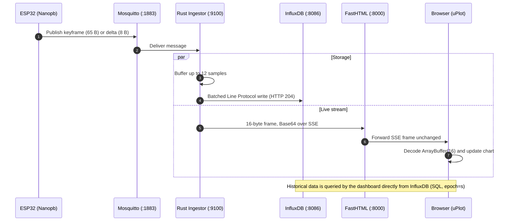

# IoT Air Quality Platform

[](https://github.com/fl0rent/iot-airquality-platform/actions/workflows/ci.yml)
[](ingestor/)
[](dashboard/)
[-informational)](contracts/)
[](#license)

An air quality monitoring platform built for constrained hardware: ESP32 sensor nodes, single-board computers (Raspberry Pi) and industrial gateways. The complete server-side stack runs in roughly 50 MB of RAM.

## Contents

- [Architecture](#architecture)
- [Repository Layout](#repository-layout)
- [Getting Started](#getting-started)
- [Resource Footprint](#resource-footprint)
- [Live Streaming Protocol](#live-streaming-protocol)
- [Security](#security)
- [Architecture Decision Records](#architecture-decision-records)
- [License](#license)

## Architecture

```
┌─────────────────────────────────────────────────────────────────────────┐
│                          ESP32 FIRMWARE (Nanopb)                        │
│  Static allocation · LittleFS store-and-forward · Hardware watchdog     │
│  Keyframes (65 B) and delta batches (8 B per sample)                    │
└────────────────────────────────────┬────────────────────────────────────┘
                                     │ MQTT, Protobuf v3 payloads
                                     ▼
                   ┌───────────────────────────────────┐
                   │          Mosquitto broker         │
                   └─────────────────┬─────────────────┘
                                     │ single subscriber
                                     ▼
                   ┌───────────────────────────────────┐
                   │         Rust ingestion hub        │
                   │  Protobuf decoding (Prost)        │
                   │  Micro-batching, circuit breaker  │
                   │  Prometheus metrics  :9100        │
                   │  Local IPC stream    :9100/stream │
                   └─────────┬───────────────┬─────────┘
                             │               │
          ┌──────────────────┘               └─────────────────────────┐
          │ Line Protocol over HTTP                                    │ Local IPC (SSE)
          ▼                                                            ▼
┌─────────────────────┐                                  ┌───────────────────────────┐
│    InfluxDB v2/v3   │◄──────── SQL queries ────────────┤    FastHTML dashboard     │
│  Time-series store  │        (history, aggregates)     │  No MQTT / Protobuf deps  │
└─────────────────────┘                                  │  In-memory sensor state   │
                                                         └─────────────┬─────────────┘
                                                                       │ SSE, 16-byte frames
                                                                       ▼
                                                         ┌───────────────────────────┐
                                                         │  Browser (HTMX + uPlot)   │
                                                         └───────────────────────────┘
```



### Components

| Component | Technology | Responsibility |
| :--- | :--- | :--- |
| Firmware | C++, PlatformIO, Nanopb | Sensor acquisition, Protobuf encoding, offline buffering on flash |
| Broker | Mosquitto | MQTT transport between nodes and the ingestor |
| Ingestor | Rust, Tokio, Prost | Decoding, batched persistence, metrics, live stream fan-out |
| Storage | InfluxDB v2/v3 | Time-series storage and historical aggregation |
| Dashboard | Python, FastHTML, uvloop, uPlot | Real-time and historical visualization |

## Repository Layout

```
iot-airquality-platform/
├── contracts/          Protobuf v3 schemas and code generation
│   ├── proto/air_quality.proto
│   └── compile.sh
├── firmware/           ESP32 firmware (PlatformIO, Nanopb)
│   ├── src/main.cpp
│   ├── include/
│   └── tools/mock_publisher.py      Telemetry simulator
├── ingestor/           Rust ingestion service
│   ├── src/main.rs
│   ├── src/metrics.rs               HTTP /metrics and /stream endpoints
│   ├── src/sink.rs                  InfluxDB batch writer
│   └── Cargo.toml
├── dashboard/          FastHTML web application
│   ├── main.py                      Application and SSE broadcaster
│   ├── stream_bridge.py             IPC client for the ingestor stream
│   ├── influx_service.py            Historical queries
│   └── static/                      CSS, JavaScript, icons
├── deploy/             Production deployment
│   ├── systemd/                     Hardened service units
│   ├── mosquitto/                   Broker configuration
│   ├── influxdb/                    Database configuration
│   └── sysctl.d/                    Kernel network tuning
├── docs/
│   ├── adr/                         Architecture Decision Records
│   ├── AIR_QUALITY_GUIDE.md         Health thresholds guide (French)
│   └── AIR_QUALITY_GUIDE_EN.md      Health thresholds guide (English)
├── scripts/
│   └── test-stack.sh                End-to-end verification
└── Makefile
```

Each component directory contains its own README with build and configuration details.

## Getting Started

### Prerequisites

- Python 3.10+
- Rust toolchain (`cargo`, `rustc`)
- GCC or Clang
- Mosquitto MQTT broker on port 1883
- InfluxDB v2.x or v3.x on port 8086

### Build and Run

```bash
make build           # Generate Protobuf code and build the ingestor (release)
make test            # Run the verification suite

make run-ingestor    # Terminal 1: start the ingestion service
make run-dashboard   # Terminal 2: start the dashboard
make run-mock        # Terminal 3: publish simulated ESP32 telemetry
```

The dashboard is available at `http://localhost:8000/`.

## Resource Footprint

Resident memory (RSS) measured on the reference deployment, against per-service budgets.

| Service | Budget | Measured RSS | Notes |
| :--- | ---: | ---: | :--- |
| Mosquitto | < 5 MB | ~3.2 MB | Memory limits in broker configuration |
| Rust ingestor | < 10 MB | ~5.8 MB | LTO, `panic = "abort"` |
| InfluxDB | < 25 MB | ~18.0 MB | 32 MB cache ceiling |
| FastHTML dashboard | < 20 MB | ~14.5 MB | Python 3.12, uvloop, single worker |
| Caddy reverse proxy | < 10 MB | ~8.0 MB | TLS termination, HTTP/3 |
| **Total** | **< 60 MB** | **~49.5 MB** | |

## Live Streaming Protocol

Live telemetry is carried from the ingestor to the browser as fixed-size 16-byte frames (struct format `>IHhHHHbB`, big-endian). The dashboard forwards frames without decoding them.

### Frame Layout

| Bytes | Field | Type | Unit |
| :--- | :--- | :--- | :--- |
| 0–3 | Timestamp | `uint32` | Unix seconds |
| 4–5 | CO2 | `uint16` | ppm |
| 6–7 | Temperature | `int16` | 0.01 °C |
| 8–9 | Humidity | `uint16` | 0.01 % |
| 10–11 | PM2.5 | `uint16` | 0.01 µg/m³ |
| 12–13 | Battery | `uint16` | mV |
| 14 | RSSI | `int8` | dBm |
| 15 (bits 4–7) | AQI level | 4-bit | 1–5 |
| 15 (bits 0–3) | Sensor index | 4-bit | 0–15 |

A frame is 16 bytes, encoded as 24 Base64 characters on the wire.

### Endpoints

The ingestor exposes the stream on `/stream` in two formats:

```bash
# Binary frames, Base64-encoded (default, used by the dashboard)
curl -N http://127.0.0.1:9100/stream
# data: aoXFKwJsCOgTJAKKDyjEIA==

# JSON, for debugging
curl -N "http://127.0.0.1:9100/stream?format=json"
# data: {"device_id":"sensor-esp32-01","co2_ppm":620,"temperature_celsius":22.8,...}
```

### Design Notes

- **Sensor limit.** The 4-bit sensor index addresses up to 16 sensors per gateway. Larger deployments can either widen the frame to 18 bytes with a 16-bit index or partition sensors across gateways.
- **Scope of the live stream.** Only the primary health metrics (CO2, PM2.5, temperature, humidity) are streamed live. Secondary metrics (TVOC, PM10, atmospheric pressure) are persisted in InfluxDB and retrieved on demand, keeping the live frame small and fixed-size.

## Security

### Secrets

> [!IMPORTANT]
> The repository ships a default InfluxDB token intended only for local development on `127.0.0.1`.
> Production tokens must never be committed. Provide them through systemd drop-ins (`/etc/systemd/system/iot-*.service.d/override.conf`), Docker secrets or a secrets manager such as HashiCorp Vault or Azure Key Vault.

### Hardening Measures

| Threat | Mitigation |
| :--- | :--- |
| Query injection ([CWE-89](https://cwe.mitre.org/data/definitions/89.html), [CWE-20](https://cwe.mitre.org/data/definitions/20.html)) | Sensor identifiers in URLs are validated against `^[a-zA-Z0-9_-]{1,64}$` before use in queries |
| Resource exhaustion ([CWE-400](https://cwe.mitre.org/data/definitions/400.html)) | At most 64 concurrent SSE clients; bounded queues with drop-oldest eviction; fixed-size ring buffers (3,600 points) |
| Buffer overflow on device ([CWE-120](https://cwe.mitre.org/data/definitions/120.html)) | Nanopb encodes into a static 256-byte buffer; no heap allocation in the transmit loop |
| Host compromise | Services run as an unprivileged user (`User=iot-service`) with systemd sandboxing: `ProtectSystem=strict`, `ProtectHome=true`, `PrivateTmp=true`, `NoNewPrivileges=true`, `LockPersonality=true`, `MemoryMax=40M` |

## Architecture Decision Records

| ADR | Title |
| :--- | :--- |
| [0001](docs/adr/0001-baremetal-protobuf-fasthtml-influx.md) | Bare-metal architecture: Protobuf, FastHTML and InfluxDB |
| [0002](docs/adr/0002-ultra-minimalist-web-performance-optimizations.md) | Frontend performance optimizations |
| [0003](docs/adr/0003-rust-central-hub-and-ipc-telemetry-streaming.md) | Rust ingestion hub and local IPC streaming |
| [0004](docs/adr/0004-v2-embedded-duckdb-storage-engine.md) | Proposed v2: embedded DuckDB storage engine |

## License

Released under the MIT License.
