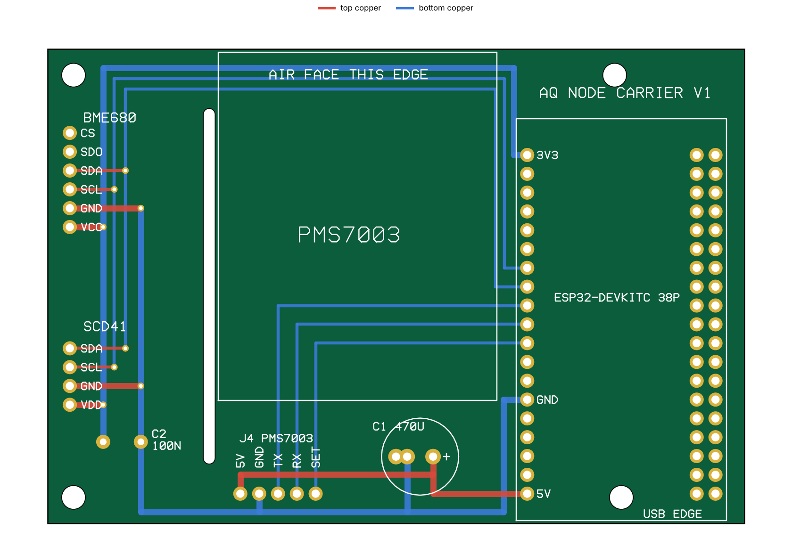

# Nœud capteur qualité d'air — ESP32 + BME680 + SCD41 + PMS7003

Prototype matériel de la plateforme : carte porteuse, firmware et boîtier imprimable.
Le nœud publie une trame Protobuf `AirQualityPacket` (une mesure complète `FullSample`, ~64 octets)
toutes les 5 s sur `sensors/<DEVICE_ID>/airquality`, conformément à `contracts/proto/air_quality.proto`.

## 1. Nomenclature

| Qté | Composant | Remarque |
| :-- | :-- | :-- |
| 1 | Carte porteuse `pcb/` | 94 × 64 mm, 2 couches, 1,6 mm, composants traversants uniquement. |
| 1 | ESP32-DevKitC 38 broches (ou clone NodeMCU-32S) | La carte accepte les deux écartements de rangées, 25,4 et 22,86 mm. |
| 1 | GY-BME680 / CJMCU-680 | 6 broches : VCC GND SCL SDA SDO CS. |
| 1 | Module SCD41 4 broches | VDD GND SCL SDA. |
| 1 | Plantower PMS7003 + carte adaptatrice et câble | Seul élément encore relié par fils (5). |
| 2 | Barrettes femelles 1×19, pas 2,54 mm | J1 et J2 : supports de l'ESP32. |
| 1 + 1 | Barrettes femelles 1×6 et 1×4 | J3 (BME680) et J5 (SCD41). |
| 1 | Barrette mâle 1×5 | J4, vers l'adaptateur du PMS7003. |
| 1 | Condensateur électrolytique 470 µF / 10 V | C1, pas de 3,5 ou 5 mm, hauteur ≤ 16 mm. |
| 1 | Condensateur céramique 100 nF | C2, pas de 5 mm. |
| 1 | Alimentation USB 5 V ≥ 500 mA + câble micro-USB | |

Consommation : ESP32 ≈ 80 mA en moyenne (pics Wi-Fi > 250 mA), PMS7003 ≤ 100 mA,
SCD41 ≈ 15 mA en moyenne (pics de 200 mA sur le 3,3 V), BME680 < 1 mA en moyenne.
Le nœud est prévu pour rester branché en USB, et `battery_millivolts` vaut 0.

## 2. Carte porteuse (`pcb/`)



| Signal | ESP32 (rangée 3V3…5V) | Destination |
| :-- | :-- | :-- |
| 3,3 V | 3V3 (broche 1) | BME680 VCC, SCD41 VDD, C2 |
| Masse | GND (broche 14) | Tous les connecteurs, C1, C2 |
| 5 V | 5V (broche 19) | J4 « 5V » → PMS7003 VCC, C1 |
| I²C SCL | GPIO32 | BME680 SCL, SCD41 SCL |
| I²C SDA | GPIO33 | BME680 SDA, SCD41 SDA |
| UART2 RX | GPIO25 | J4 « TX » → PMS7003 TX (broche 9) |
| UART2 TX | GPIO26 | J4 « RX » → PMS7003 RX (broche 7) |
| Veille | GPIO27 | J4 « SET » → PMS7003 SET (broche 10) |

Choix de conception :

- **Tout passe par une seule rangée de l'ESP32**, celle qui fait face aux capteurs. L'autre rangée n'est qu'un
  support mécanique, percée aux deux écartements courants. Les broches diffèrent donc du câblage par fils
  initial (21/22/16/17/4) ; `firmware/include/config.h` est aligné sur la carte.
- **Isolation thermique des capteurs** : pas de plan de masse, et une fente fraisée sépare la zone BME680/SCD41
  du reste. Les pistes ne franchissent la fente qu'aux deux extrémités.
- **Sous le PMS7003** (boîtier métallique posé sur la carte) : aucune pastille, aucun via, et du cuivre
  uniquement sur la face inférieure.
- SDO et CS du BME680 restent en l'air : mode I²C, adresse fixée par le breakout (`0x77` en général, sinon
  changer `BME680_I2C_ADDR`).

**Sens des capteurs.** Chaque module se pose à plat au-dessus de la carte, corps vers l'intérieur. Soudez la
barrette mâle du breakout du côté qui fait correspondre ses broches aux noms sérigraphiés (VCC en bas pour le
BME680, VDD en bas pour le SCD41, carte vue de dessus, USB vers vous). Vérifiez au multimètre avant de mettre
sous tension : un module retourné inverse l'alimentation.

**Fabrication.** `pcb/carrier-gerbers.zip` se dépose tel quel chez JLCPCB, PCBWay ou Aisler (2 couches, 1,6 mm,
HASL). Le zip contient les deux couches cuivre, les vernis, la sérigraphie, le contour avec la fente, et les
perçages métallisés et non métallisés.

La carte est décrite par `pcb/carrier.py`, qui la route, la contrôle puis exporte les Gerber. Le contrôle
intégré vérifie les isolements (0,30 mm minimum exigé, 0,70 mm obtenu), la continuité de chaque net, les
distances aux bords, à la fente et aux trous de fixation, et l'absence de cuivre supérieur sous le PMS7003.
**Les Gerber n'ont pas été ouverts dans un visualiseur tiers ni dans KiCad** : passez-les dans l'aperçu du
fabricant (ou `gerbv`) et comparez avec `pcb/preview.png` avant de commander. Il n'y a pas de projet KiCad.

## 3. Firmware

```bash
cd firmware
cp include/secrets.example.h include/secrets.h   # Wi-Fi, broker MQTT, DEVICE_ID
pio run -e esp32dev -t upload && pio device monitor
pio run -e esp32dev-mock -t upload               # sans capteurs : données synthétiques
NANOPB_DIR=/chemin/vers/nanopb test_host/run.sh  # test hors cible : parseur PMS + encodage Protobuf
```

| Champ Protobuf | Source | Commentaire |
| :-- | :-- | :-- |
| `temperature_celsius`, `humidity_percent` | BME680 via BSEC | Compensées de l'auto-échauffement du capteur ; corriger celui du boîtier avec `BME_TEMP_OFFSET_C`. |
| `pressure_hpa` | BME680 | |
| `co2_ppm` | SCD41 | Mesure réelle, une toutes les 5 s, compensée en pression par le BME680. |
| `tvoc_ppb` | BSEC « breath VOC équivalent » × 1000 | Voir les limites ci-dessous. |
| `pm25_ug_m3`, `pm10_ug_m3` | PMS7003, valeurs « atmosphériques » | Moyenne des trames reçues entre deux envois. |
| `base_timestamp_sec` | NTP (UTC) | 0 tant que l'heure n'est pas synchronisée : l'ingestor horodate alors lui-même. |
| `status` | — | `WARMING_UP` : 30 s de stabilisation du PMS, ~5 min de calibration BSEC. `DEGRADED` : un capteur muet (ses champs valent 0). `FAULT` : tous. |

Le SCD41 est piloté par un pilote maison de ~60 lignes (`include/scd4x.h`), sans dépendance supplémentaire.

Comportement : boucle non bloquante (BSEC impose son propre cadencement à 3 s), reconnexion Wi-Fi/MQTT en tâche
de fond, file d'attente LittleFS hors ligne rejouée à la reconnexion (les trames produites avant la
synchronisation NTP ne sont pas mises en file, faute de pouvoir être datées au rejeu), état de calibration BSEC sauvegardé en
flash toutes les 6 h, watchdog matériel à 15 s.

### Limites à connaître

- **Auto-calibration du SCD41.** Activée par défaut, elle suppose que le capteur voit de l'air frais (~400 ppm)
  au moins une fois par semaine. Dans une pièce jamais aérée, la mesure dérive : aérer régulièrement ou
  désactiver l'ASC et faire une recalibration forcée.
- **Auto-échauffement.** Le SCD41 partage la chambre du BME680 et y dissipe ~50 mW : cela s'ajoute à l'écart
  de température à corriger avec `BME_TEMP_OFFSET_C`.
- **Échelle des COV.** `tvoc_ppb` est le « breath-VOC équivalent » de BSEC (~500 ppb en air propre). Les seuils
  de l'ingestor (seul endroit où l'indice est calculé) sont calés sur cette échelle : 800 / 1900 / 4800 / 12000 ppb, soit les classes
  IAQ de Bosch (indice statique 50 / 100 / 150 / 200). La conversion indice → ppb repose sur deux relevés BSEC
  publiés seulement, Bosch ne documentant pas la formule : la ligne `[TX]` du moniteur série affiche `sIAQ` et
  `bVOC` côte à côte pour la vérifier sur votre capteur et ajuster les seuils.
- **BSEC est une bibliothèque propriétaire Bosch** (binaire précompilé, licence à accepter), ce qui est à
  vérifier avant toute diffusion commerciale.
- **Rodage.** Le capteur de gaz d'un BME680 neuf demande ~48 h de fonctionnement avant de se stabiliser ;
  BSEC affine ensuite sa calibration sur 4 jours.
- **Durée de vie du PMS7003** : ≥ 3 ans en continu selon le constructeur. Pour l'allonger, passer à une mesure
  par intermittence via la broche SET (30 s de stabilisation à chaque réveil).
- Les paquets mis en file avant la toute première synchronisation NTP n'ont pas d'horodatage propre.

## 4. Boîtier (impression 3D)

`enclosure/body.stl` et `enclosure/lid.stl` — 100 × 70 × 32 mm, conçus autour de la carte porteuse.

```
              grille PMS7003 (paroi arrière)
 ┌───────────┬──────────────────────┬───────────────────┐
 │ BME680 +  │      PMS7003         │      ESP32        │
 │ SCD41     │   posé sur la carte  │   sur supports    │
 │ chambre   ├──────────────────────┤                   │
 │ ventilée  │   J4, C1             │                   │
 └───────────┴──────────────────────┴───────────────────┘
   ouïes sur 3 côtés                   USB (paroi avant), ouïes dans le couvercle
```

- La carte se pose sur quatre plots à ergot (trous de 3,2 mm), 3 mm au-dessus du fond.
- La cloison de la chambre capteurs est portée par le couvercle : elle descend jusqu'à la fente de la carte,
  et une nervure du fond ferme le passage sous la carte.
- Le couvercle plaque le PMS7003 sur la carte et le cale latéralement ; sa face d'aspiration vient contre la grille.
- Orientation conseillée : à plat, ou accroché verticalement avec la chambre capteurs en bas (la chaleur monte).

Impression : PLA ou PETG, couches de 0,2 mm, 3 périmètres, 20 % de remplissage, **sans supports**.
Le corps s'imprime ouverture vers le haut, le couvercle plaque sur le plateau (déjà orienté dans le STL).

Le modèle est paramétrique : `python3 enclosure/enclosure.py --preview` régénère les STL, l'export OpenSCAD
et l'aperçu (numpy seul requis, matplotlib pour l'aperçu). Points à vérifier sur vos pièces avant d'imprimer :

| Paramètre | Défaut | À vérifier |
| :-- | :-- | :-- |
| `SOCKET_H` | 8,5 mm | Hauteur de vos barrettes femelles : elle fixe la hauteur de l'ouverture USB. |
| Grille PMS7003 | face de 37 × 12 mm | Le modèle suppose l'aspiration et le refoulement sur la petite face opposée au connecteur. |
| Butées du PMS7003 | coins de la face connecteur | Elles ne doivent pas gêner l'adaptateur ; sinon réduire leur largeur dans `lid_ops()`. |
| `INNER_H` | 28 mm | Hauteur libre pour les fils Dupont sur J4 ; réductible si les fils sont soudés. |
| `FIT` | 0,25 mm | Jeu du couvercle, à ajuster selon l'imprimante. |

## 5. Mise en service

1. Souder dans l'ordre : barrettes femelles, J4, C2, puis C1 (attention à sa polarité, « + » sérigraphié).
2. Sans rien enficher, alimenter l'ESP32 seul sur la carte et mesurer 3,3 V entre VCC et GND de J3 et J5, 5 V sur J4.
3. Enficher les capteurs, relier le PMS7003 à J4, flasher, puis vérifier dans le moniteur série :
   `SCD41 Periodic measurement started`, `BSEC x.x.x.x ready`, et une ligne `[TX]` toutes les 5 s.
4. Contrôler l'arrivée des trames : `mosquitto_sub -t 'sensors/+/airquality' | xxd`, puis le tableau de bord.
5. Monter dans le boîtier, laisser tourner 48 h, puis régler `BME_TEMP_OFFSET_C` face à un thermomètre de référence.
